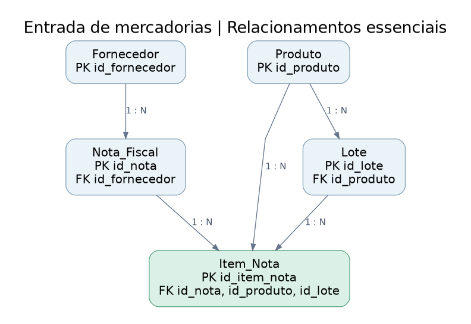

# Supermercado Preço Bom — Banco de Dados MySQL

**Projeto acadêmico em grupo | Engenharia de Software | Universidade Cruzeiro do Sul**

Modelagem de um banco de dados relacional para apoiar operações de um supermercado: produtos, fornecedores, notas fiscais, lotes, estoque, perdas, vendas e fechamento de caixa.

> Este repositório apresenta **apenas o banco de dados e suas consultas**. Não inclui site, aplicativo ou autenticação funcional. Os registros são **fictícios**, usados para demonstração.

## Tecnologias e conceitos

- **MySQL** e MySQL Workbench
- SQL: `CREATE TABLE`, `ALTER TABLE`, `INSERT INTO`, `SELECT`, `JOIN`, `GROUP BY` e `ORDER BY`
- Modelagem relacional, chaves primárias (`PRIMARY KEY`), estrangeiras (`FOREIGN KEY`) e restrições (`NOT NULL`, `UNIQUE`)

## Funcionalidades modeladas

- Cadastro de produtos, categorias, unidades de medida e fornecedores
- Registro de notas fiscais de entrada e itens recebidos
- Rastreamento por lote e validade; controle de estoque no depósito e na gôndola
- Registro de movimentações, perdas e solicitações de reposição
- Vendas, pagamentos, cancelamentos, operações de caixa e conferência de valores

## Estrutura

O script contém **25 tabelas**, **33 declarações de chaves estrangeiras** e **9 consultas SELECT** para apoiar relatórios. A contagem corresponde ao arquivo disponibilizado, não a uma execução homologada em MySQL.



*Diagrama parcial, voltado ao fluxo de fornecedores e notas fiscais. O banco completo tem 25 tabelas.*

## Como executar

1. Instale o MySQL e abra o **MySQL Workbench** com uma conexão local de teste.
2. Abra [`supermercado_preco_bom.sql`](supermercado_preco_bom.sql) (**File > Open SQL Script**).
3. Execute o script completo em um ambiente vazio, com permissão para criar o banco `supermercado_preco_bom`.
4. Atualize a lista de esquemas e examine as tabelas. As nove consultas `SELECT` estão no fim do arquivo.

**Atenção:** o script cria um banco e tabelas, além de inserir registros demonstrativos; ele **não é idempotente** para múltiplas execuções sem limpeza prévia. Não execute em instâncias que contenham dados importantes. Não foi realizado teste de execução em servidor MySQL nesta preparação.

## Exemplo de consulta

Faturamento por caixa (PDV) e dia, excluindo vendas canceladas:

```sql
SELECT pd.Numero AS PDV,
       DATE(v.Data_Hora) AS Dia,
       SUM(v.Valor_Total) AS Faturamento
FROM Venda v
JOIN Caixa cx ON cx.id_caixa = v.id_caixa
JOIN PDV pd ON pd.id_pdv = cx.id_pdv
WHERE v.Status = 'FINALIZADA'
GROUP BY pd.Numero, DATE(v.Data_Hora);
```

## Participação no trabalho

Este projeto foi desenvolvido **em equipe** na disciplina de Modelagem de Banco de Dados. **Lucas Gabriel** participou do estudo e da apresentação do bloco de **fornecedores e notas fiscais**, envolvendo as tabelas `Fornecedor`, `Nota_Fiscal` e `Item_Nota` e seus relacionamentos. As contribuições dos demais integrantes também fazem parte do projeto original.

> **Créditos ao grupo:** acrescentar os nomes ou links dos colegas conforme autorização deles. Publicar este material somente após alinhar a divulgação com a equipe.

## Arquivos

- [`supermercado_preco_bom.sql`](supermercado_preco_bom.sql) — estrutura, vínculos, dados fictícios e consultas
- [`diagramas/relacionamento_mercadorias.png`](diagramas/relacionamento_mercadorias.png) — diagrama parcial
- [`docs/guia_de_estudo.md`](docs/guia_de_estudo.md) — explicação para estudar e apresentar

## Limitações e melhorias futuras

- Trabalho acadêmico demonstrativo, **não é sistema pronto para produção**.
- Não existe aplicação de autenticação: a coluna `Senha` contém valores **fictícios, não utilizáveis**.
- Validações de domínio, conferência de valores entre itens e notas, e regras adicionais de consistência podem ser aprimoradas.
- Como evolução, adicionar testes de integração em MySQL, documentação das consultas e validação de relacionamentos entre produto e lote.
- Nenhuma licença de reutilização foi atribuída: os direitos do projeto devem ser combinados entre os autores.
